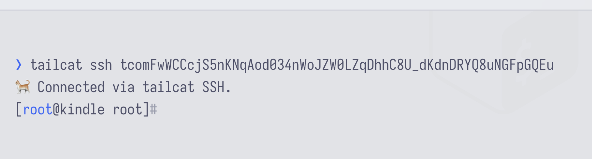

# Tailcat for Kindle (KUAL)




Like tailscale_kual but without the management plane of tailscale.

<br>
<br>

| <samp><samp> </sampy><samp> | Tailcat (tailcat_kual) | Tailscale Taildrop (tailscale_kual) | bare metal service |
|---|---|---|---|
| Account required | ✅ No account required | ❌ Requires Tailscale account | ✅ No third-party account required |
| DNS permissions | ✅ No DNS hassle | ⚠️ May require DNS configuration/permissions - macos tailscaled deamon issues etc. | ⚠️ Depends on setup |
| Key expiration | ✅ None | ⚠️ Tailscale key expiry 90 days | ⚠️ SSH keys and credentials need management |
| Allows SSH | ✅  | ✅  | ⚠️ Depends on setup |
| Allows file transfer | ✅  | ✅  | ⚠️  Depends on setup |
| Can be reached programmatically? | ✅ Yes. Even over WebRTC |  ❌ Kindle needs to be within same tailnet as App/Service | ❌ Requires dedicated server resources |


<br> 

## Prerequisites:

0. The [minimum kernel version reqirement](https://go.dev/wiki/MinimumRequirements) for [Go](https://go.dev/) (and hence [tailscale](https://github.com/tailscale/tailscale)) is `2.6.32`. You should check your kernel version via `uname -r` before proceeding.
1. Jailbroken Kindle ([see](https://kindlemodding.gitbook.io/kindlemodding)) running 32-bit ARMv7 (qrencode uses armel binaries) 
2. [KUAL](https://wiki.mobileread.com/wiki/KUAL) installed. ([see](https://kindlemodding.gitbook.io/kindlemodding/post-jailbreak/installing-kual-mrpi))

<br>

## Installation:

#### 1. Download the repository.

####  2. Place the **tailcat** (not the `tailcat_kual`) folder into the `extensions` folder on your kindle.

####  3. In the KUAL menu, tap **Install / Update Tailcat**. This will download the latest `tailcat` and `qrencode` binaries (Wi-Fi connection necessary). 

####  4. Generate Default Address (recommended)

>> By default, Tailcat generates a random, temporary tailcat address every time it starts. **Generate Default Key** creates a persistent one. This ensures a reusable tailcat address across **restarts and reboots**.

####  5. Retrieve the tailcat address 

>>  The address is printed to the screen and saved as a high-res QR code inside `/mnt/us/tailcat_qr.png` - view inside Koro Reader etc.
>>  it looks like **tcomFwWCCcjS5..._dKdnDRYQ8uNGF**

<br><br>


## Usage Modes:

####  [ Start Tailcat ]  Tailcat file listener mode (SFTP drop box) 

> Any instance (and anyone) running tailcat can push files to the kindle (works from the Web via WebRTC too)  
```bash
tailcat ping tcomFwWCCcjS5..._dKdnDRYQ8uNGF # should respond with pong 
tailcat cp tailcat_test.epub tcomFwWCCcjS5..._dKdnDRYQ8uNGF: # keep the : 
```
> Files are stored  ```/mnt/us/extensions/tailcat/``` by default. You can change this by editing the start_tailcat.sh file inside /bin

####  [ Start Insecure SSH ] Tailcat ssh mode

This spawn an encrypted tunnel which can establish a ssh connection by providing the tailcat address. Start Insecure SSH is basically ``tailcat serve no-auth-ssh``. The tailcat address is the sole identifier to access (root) of the kindle. ***Anyone*** with the tailcat adress has access to it. 

This allows a seemless ssh tunnel from another device to the kindle without any setup 
```bash
tailcat ssh <KINDLE_TAILCAT_ADDRESS> 
```

####  [ Stop Tailcat ]

It does exactly what it says. 


<br><br>

## Final Notes

- **Insecure SSH Warning**: The "Start Insecure SSH" mode opens an SSH server on your Kindle **without requiring a password or SSH keys**. While this is incredibly convenient for quick file transfers or terminal access, it is inherently dangerous. **Only use this on a trusted network** and remember to tap **Stop Tailcat** when you are finished.
- **Logs**: Logs are stored in the `/mnt/us/extensions/tailcat/bin/` directory 
- **Kernel Limitations**: If your Kindle's kernel is older than `2.6.32`, the Tailcat binary will likely crash or fail to start due to missing system calls required by modern Go binaries.

- **Does it work on my kindle?**: If have no idea, this was tested on a pw2 32-bit ARMv7 (ARMel) kindle, which should support all other kindles running the ARMel port. If someone has a newer kindle, I cann add ARMhf support, just open an issue. 

Thank you mitanshu7 for providing the predecessor https://github.com/mitanshu7/tailscale_kual.
